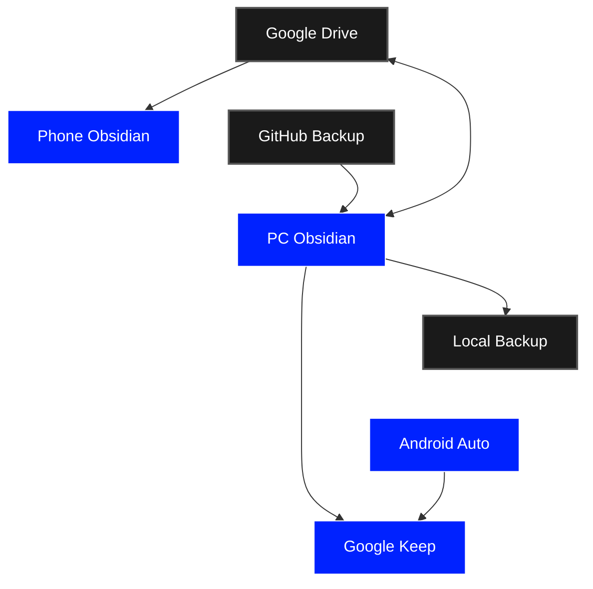
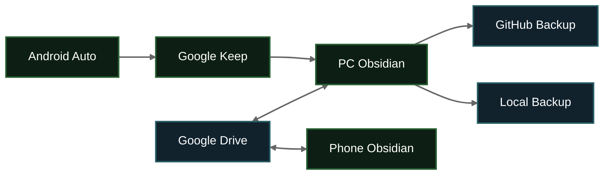

```gr
car->keep;
keep->pc;
phone->drive; drive->phone;
pc->drive; drive->pc;
pc->github;
pc->local;
: [
drive:{name="Google Drive",color="black",text=""};
local:{name="Local Backup",color="black",text=""};
github:{name="GitHub Backup",color="black",text=""};
phone:{name="Phone Obsidian",color="blue",text=""};
pc:{name="PC Obsidian",color="blue",text=""};
car:{name="Android Auto",color="blue",text=""};
keep:{name="Google Keep",color="blue",text=""};
]
```




```
nosygraph

rootNodes: "[[PC Obsidian]]"
linkTypeFolder: "NosyGraph/LinkTypes"
rootNodeProperties: syncs_with, backups_to, sends_to
visibleLinkTypes: syncs_with, backups_to, sends_to
```


