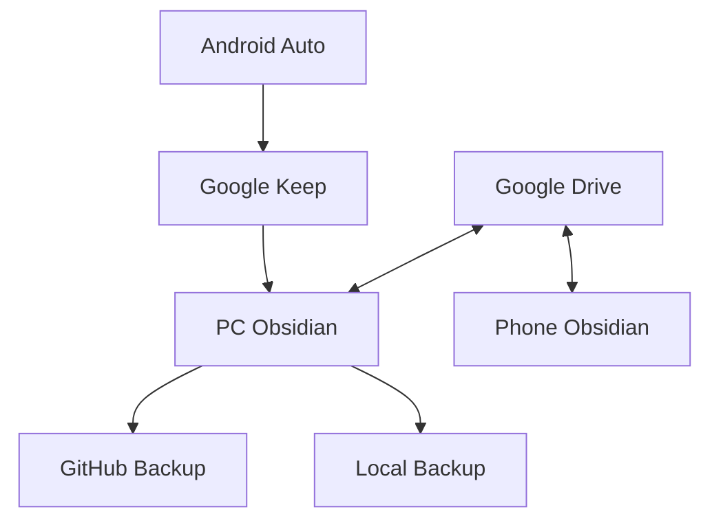

This is a dedicated graph document view.


## Graph Data
```o3graph
{
  "version": 2,
  "viewport": {
    "zoom": 0.10809659631650313,
    "x": 6341.512513729684,
    "y": 5880.28919350456
  },
  "ui": {
    "linkTypeMenu": {
      "width": 260,
      "height": 360
    }
  },
  "notes": {
    "file_1": {
      "path": "NosyGraph/LinkTypes/backups_to.md"
    },
    "file_2": {
      "path": "NosyGraph/LinkTypes/sends_to.md"
    },
    "file_3": {
      "path": "NosyGraph/LinkTypes/syncs_with.md"
    },
    "file_4": {
      "path": "NosyGraph/Nodes/PC Obsidian.md"
    }
  },
  "nodes": {
    "node_1": {
      "noteId": "file_1",
      "x": -24059.34686822483,
      "y": -6899.303464812211,
      "pinned": false,
      "origin": {
        "kind": "root"
      }
    },
    "node_2": {
      "noteId": "file_2",
      "x": 5635.494518237223,
      "y": 23151.111454903774,
      "pinned": false,
      "origin": {
        "kind": "root"
      }
    },
    "node_3": {
      "noteId": "file_3",
      "x": -1590.6765237559314,
      "y": -1038.2946051323086,
      "pinned": false,
      "origin": {
        "kind": "root"
      }
    },
    "node_4": {
      "noteId": "file_4",
      "x": 19040.59510084936,
      "y": -14196.315114863412,
      "pinned": false,
      "origin": {
        "kind": "root"
      }
    }
  }
}
```


