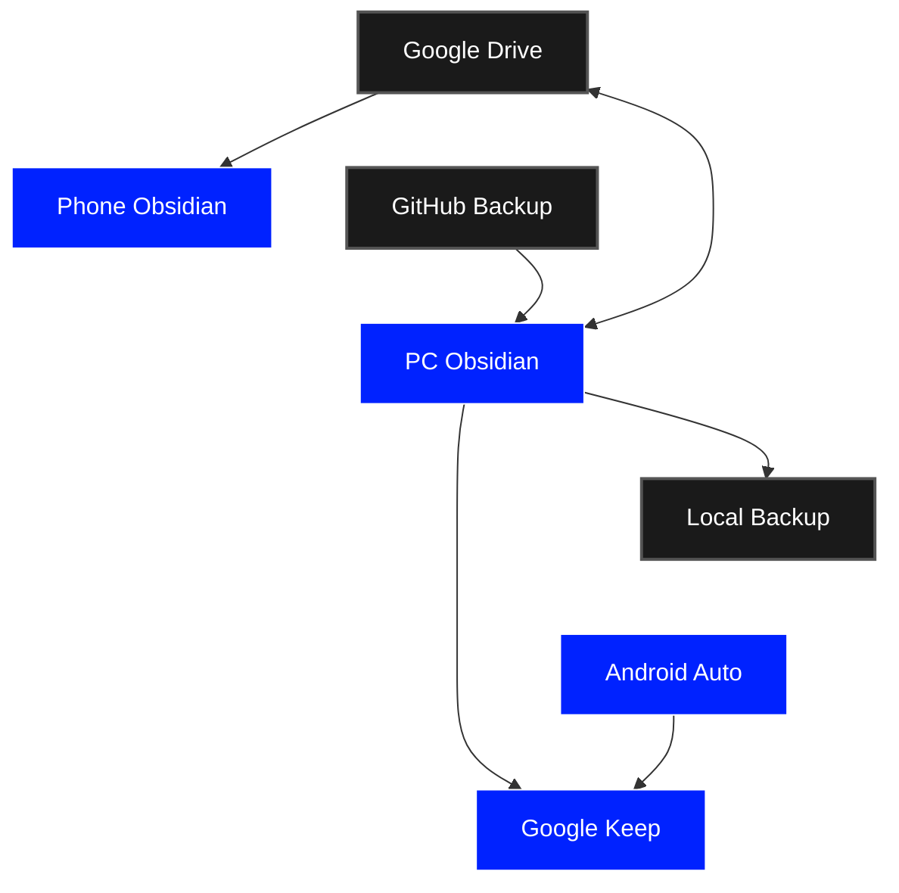
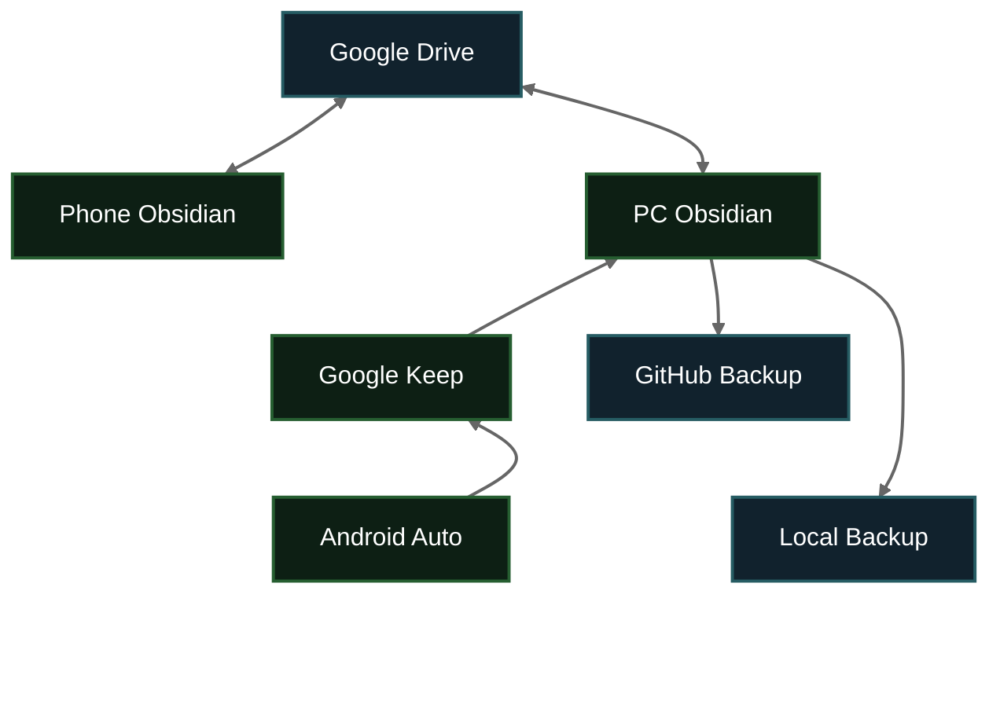
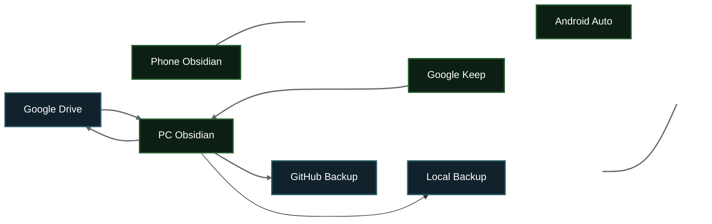

```gr
car->keep;
keep->pc;
phone->drive; drive->phone;
pc->drive; drive->pc;
pc->github;
pc->local;
: [
drive:{name="Google Drive",color="black",text=""};
local:{name="Local Backup",color="black",text=""};
github:{name="GitHub Backup",color="black",text=""};
phone:{name="Phone Obsidian",color="blue",text=""};
pc:{name="PC Obsidian",color="blue",text=""};
car:{name="Android Auto",color="blue",text=""};
keep:{name="Google Keep",color="blue",text=""};
]
```


```mermaid
graph TB
    %% Column Alignment Pins (Invisible Links)
    GD --- PhO --- AA_Pad
    PO --- GK --- AA
    GH --- LB --- LB_Pad

    %% Active Diagram Connections
    GD <--> PO
    GD <--> PhO
    GK --> PO
    AA --> GK
    PO --> GH
    PO --> LB

    %% Node Definitions & Text Content
    GD[Google Drive]:::blue
    PO[PC Obsidian]:::green
    PhO[Phone Obsidian]:::green
    GK[Google Keep]:::green
    AA[Android Auto]:::green
    GH[GitHub Backup]:::blue
    LB[Local Backup]:::blue

    %% Invisible Padding Nodes for Symmetry
    AA_Pad[ ]:::invisible
    LB_Pad[ ]:::invisible

    %% Styling and Theming
    classDef blue fill:#11222d,stroke:#265c63,stroke-width:2px,color:#fff;
    classDef green fill:#0d1f14,stroke:#265e31,stroke-width:2px,color:#fff;
    classDef invisible fill:none,stroke:none,color:none;
    
    linkStyle 0,1,2,3,4,5 stroke:none; %% Hides grid alignment links
    linkStyle 6,7,8,9,10,11 stroke:#666,stroke-width:2px; %% Shows active flow lines
```





